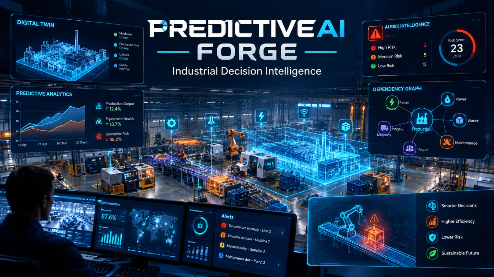
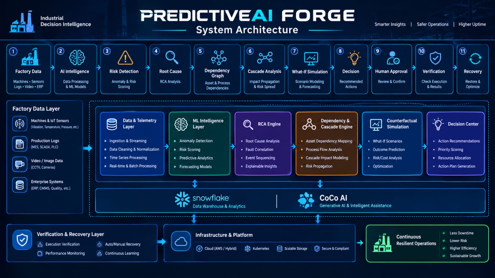
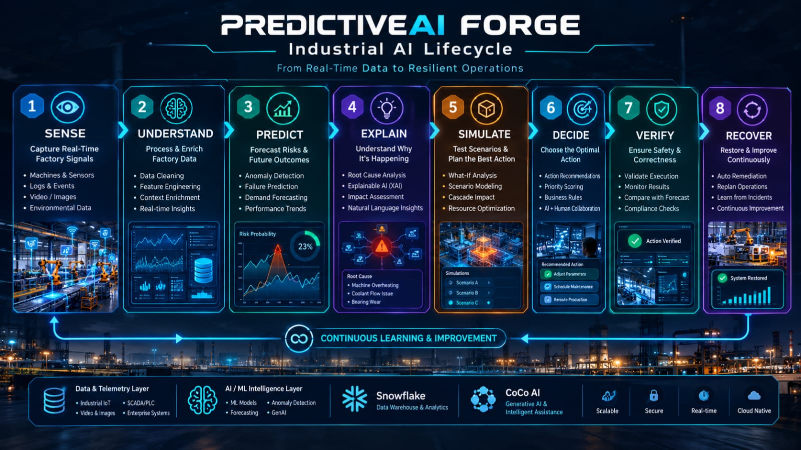
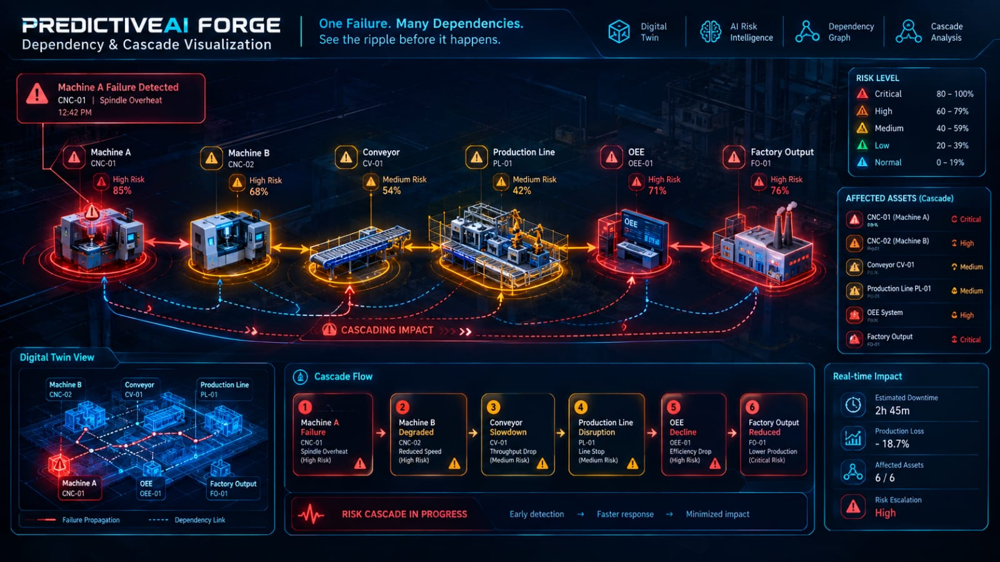
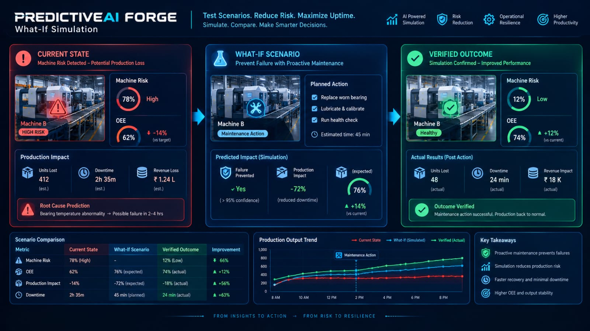
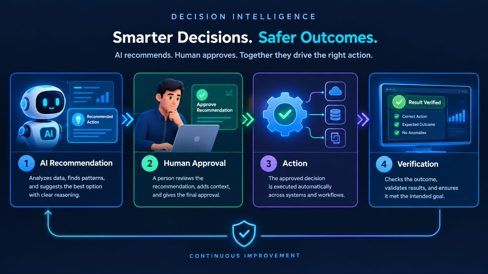
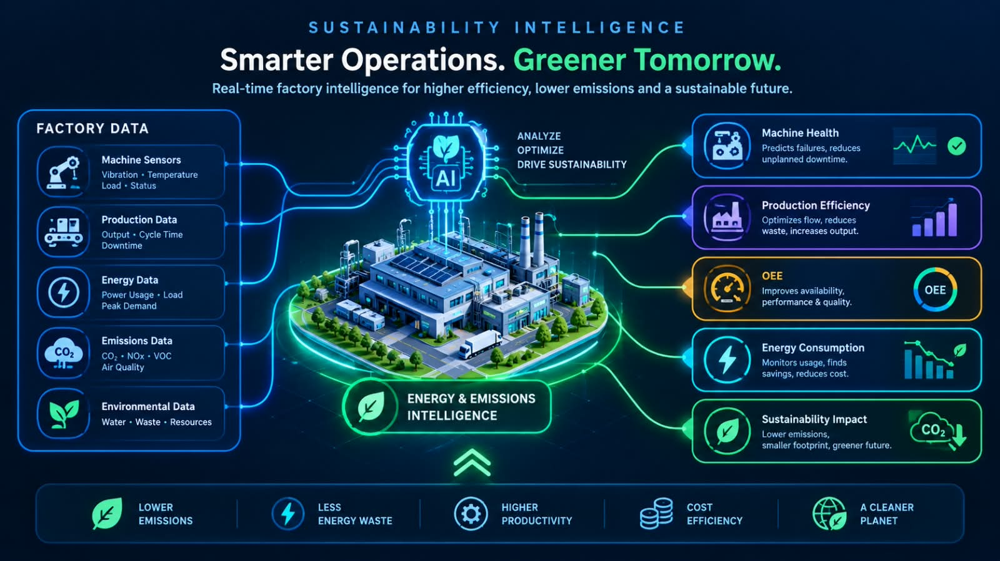
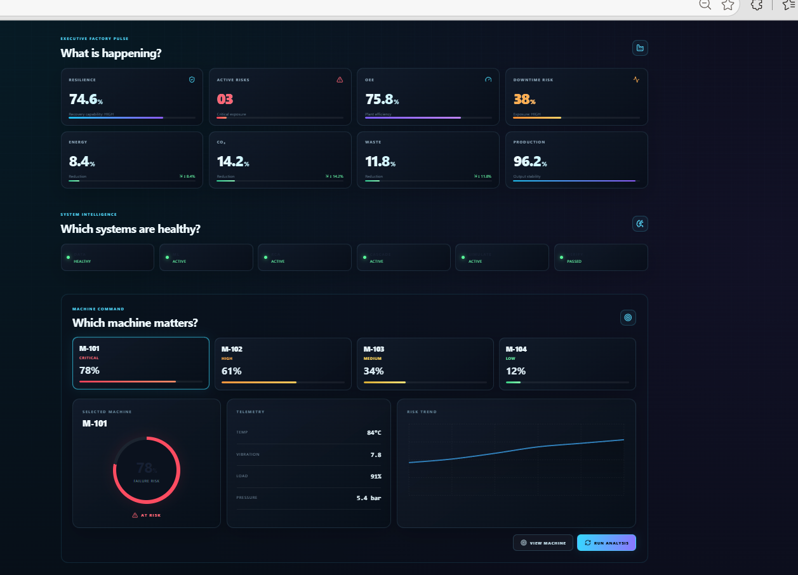

[🚀 Live Dashboard](https://predictive-ai-forge.netlify.app)

[📦 GitHub Repository](https://github.com/snehassneha4578-collab/PredictiveAI-Forge)

\# ⚡ PREDICTIVEAI FORGE


\## 🏭 Industrial Decision Intelligence Platform


<p align="center">

&#x20; 

</p>


<p align="center">

&#x20; <strong>AI Prediction • Root-Cause Intelligence • Cascade Analysis • Counterfactual Simulation • Decision Verification</strong>

</p>


<p align="center">

&#x20; 

&#x20; 

&#x20; 

&#x20; 

</p>


\---


\## 🚀 What is PredictiveAI Forge?


\*\*PredictiveAI Forge\*\* is an industrial decision-intelligence platform designed to go beyond conventional predictive maintenance.


Instead of stopping at:


> \*\*"Which machine might fail?"\*\*


PredictiveAI Forge explores:


> \*\*What is happening, why is it happening, what could happen next, which systems could be affected, what happens under alternative scenarios, and what decision should a human approve?\*\*


\### Core Intelligence Loop


```text

DATA

&#x20; ↓

INTELLIGENCE

&#x20; ↓

PREDICTION

&#x20; ↓

ROOT CAUSE

&#x20; ↓

DEPENDENCY

&#x20; ↓

CASCADE IMPACT

&#x20; ↓

WHAT-IF SIMULATION

&#x20; ↓

DECISION

&#x20; ↓

HUMAN APPROVAL

&#x20; ↓

VERIFICATION

```


\---


\# 📸 Live Industrial Command Center


<p align="center">

&#x20; 

</p>


The command center combines factory-level intelligence into one operational interface.


\### Dashboard Modules


\* 🏭 Executive Factory Pulse

\* 🧠 System Intelligence

\* ⚙️ Machine Command

\* 🔴 Risk Distribution

\* 🛡️ Resilience Index

\* 🔍 Root-Cause Engine

\* 🕸️ Dependency \& Cascade Graph

\* 🧪 Counterfactual Lab

\* 📊 OEE Intelligence

\* 🌱 Sustainability Intelligence

\* 👤 Decision Center

\* ✅ Verification Center

\* 🧾 Decision Trace

\* ⚡ Live Event Feed


\---


\# 🧩 System Architecture


<p align="center">

&#x20; 

</p>


The platform connects industrial data, AI intelligence, simulation and decision verification.


```text

┌───────────────────────┐

│   FACTORY DATA        │

│   TELEMETRY           │

└───────────┬───────────┘

&#x20;           ↓

┌───────────────────────┐

│  AI INTELLIGENCE      │

│  RISK DETECTION       │

└───────────┬───────────┘

&#x20;           ↓

┌───────────────────────┐

│  ROOT-CAUSE ENGINE    │

└───────────┬───────────┘

&#x20;           ↓

┌───────────────────────┐

│ DEPENDENCY + CASCADE  │

└───────────┬───────────┘

&#x20;           ↓

┌───────────────────────┐

│ COUNTERFACTUAL LAB    │

└───────────┬───────────┘

&#x20;           ↓

┌───────────────────────┐

│   DECISION CENTER     │

└───────────┬───────────┘

&#x20;           ↓

┌───────────────────────┐

│   HUMAN APPROVAL      │

└───────────┬───────────┘

&#x20;           ↓

┌───────────────────────┐

│     VERIFICATION      │

└───────────────────────┘

```


\---


\# 🔄 Intelligence Workflow


<p align="center">

&#x20; 

</p>


\## SENSE → UNDERSTAND → PREDICT → EXPLAIN → SIMULATE → DECIDE → VERIFY → RECOVER


| Stage             | Intelligence                                |

| ----------------- | ------------------------------------------- |

| 👁️ \*\*Sense\*\*     | Interpret machine and operational telemetry |

| 🧠 \*\*Understand\*\* | Build a system-level operational picture    |

| 🔮 \*\*Predict\*\*    | Identify emerging risks                     |

| 🔍 \*\*Explain\*\*    | Identify contributing/root causes           |

| 🧪 \*\*Simulate\*\*   | Explore alternative scenarios               |

| 🎯 \*\*Decide\*\*     | Generate an actionable recommendation       |

| 👤 \*\*Verify\*\*     | Keep humans in the approval loop            |

| ♻️ \*\*Recover\*\*    | Track recovery and resilience               |


\---


\# 🔴 Failure \& Risk Intelligence


PredictiveAI Forge transforms operational signals into machine-level and factory-level risk intelligence.


The system can surface:


\* Machine risk

\* Operational anomalies

\* Critical assets

\* Active risks

\* Recovery capability

\* Factory resilience


The objective is not simply to generate an alert, but to provide context around the risk.


\---


\# 🧠 Root-Cause Intelligence


The \*\*Root-Cause Engine\*\* helps move from:


```text

SYMPTOM

&#x20;  ↓

CONTRIBUTING FACTORS

&#x20;  ↓

ROOT-CAUSE SIGNALS

&#x20;  ↓

SYSTEM IMPACT

```


This gives decision-makers more context before considering an intervention.


\---


\# 🕸️ Dependency \& Cascade Intelligence


<p align="center">

&#x20; 

</p>


Industrial systems are interconnected.


A problem in one machine can propagate through dependent assets and production processes.


```text

Machine A

&#x20;  ↓

Machine B

&#x20;  ↓

Production Line

&#x20;  ↓

OEE

&#x20;  ↓

Factory Output

```


PredictiveAI Forge models these relationships to expose:


\* Dependent assets

\* Risk propagation

\* Downstream impact

\* Cascade paths

\* Production consequences


This turns isolated machine alerts into \*\*system-level risk intelligence\*\*.


\---


\# 🧪 Counterfactual Intelligence


<p align="center">

&#x20; 

</p>


The \*\*Counterfactual Lab\*\* explores alternative operational scenarios.


Instead of only asking:


> \*\*"What is likely to happen?"\*\*


the system can explore:


> \*\*"What could happen if we take a different action?"\*\*


Scenario analysis can consider:


\* Current risk

\* Intervention

\* Failure continuation

\* Production impact

\* OEE implications

\* Recovery implications


This connects \*\*prediction with decision support\*\*.


\---


\# 👤 Human-Supervised Decision Center


<p align="center">

&#x20; 

</p>


PredictiveAI Forge follows a \*\*human-supervised decision model\*\*.


```text

AI RECOMMENDATION

&#x20;       ↓

HUMAN REVIEW

&#x20;       ↓

HUMAN APPROVAL

&#x20;       ↓

ACTION

&#x20;       ↓

VERIFICATION

```


The system is designed to support operational decision-making rather than silently execute consequential actions.


\---


\# 📊 OEE Intelligence


PredictiveAI Forge connects machine-level intelligence with production effectiveness.


The platform considers dimensions such as:


\* Availability

\* Performance

\* Quality

\* Production impact

\* Recovery implications


This helps connect individual machine events with broader factory performance.


\---


\# 🌱 Sustainability Intelligence


<p align="center">

&#x20; 

</p>


PredictiveAI Forge extends industrial intelligence into sustainability considerations.


```text

Machine Health

&#x20;     ↓

Production Efficiency

&#x20;     ↓

OEE

&#x20;     ↓

Energy Considerations

&#x20;     ↓

Sustainability Impact

```


This allows operational decisions to be viewed in a broader factory context.


\---


\# 🧾 Decision Trace


Every important intelligence stage can be represented as a traceable decision flow:


```text

Risk Detected

&#x20;    ↓

Evidence Gathered

&#x20;    ↓

Root Cause

&#x20;    ↓

Dependency Analysis

&#x20;    ↓

Scenario Simulation

&#x20;    ↓

Recommendation

&#x20;    ↓

Human Decision

&#x20;    ↓

Verification

```


This provides a structured explanation of how the system moves from \*\*observation to decision\*\*.


\---


\# ✅ Verification Center


The platform includes a verification stage after decision-making.


```text

DECISION

&#x20;  ↓

EXPECTED OUTCOME

&#x20;  ↓

OBSERVED RESULT

&#x20;  ↓

VERIFICATION

```


This closes the loop instead of treating an AI recommendation as the final step.


\---


\# 🏭 End-to-End Industrial Decision Loop


```text

┌─────────────────┐

│  FACTORY DATA   │

└────────┬────────┘

&#x20;        ↓

┌─────────────────┐

│   PREDICTION    │

└────────┬────────┘

&#x20;        ↓

┌─────────────────┐

│  ROOT CAUSE     │

└────────┬────────┘

&#x20;        ↓

┌─────────────────┐

│  DEPENDENCIES   │

└────────┬────────┘

&#x20;        ↓

┌─────────────────┐

│ CASCADE IMPACT  │

└────────┬────────┘

&#x20;        ↓

┌─────────────────┐

│ WHAT-IF LAB     │

└────────┬────────┘

&#x20;        ↓

┌─────────────────┐

│ DECISION        │

└────────┬────────┘

&#x20;        ↓

┌─────────────────┐

│ HUMAN APPROVAL  │

└────────┬────────┘

&#x20;        ↓

┌─────────────────┐

│ VERIFICATION    │

└─────────────────┘

```


\---


\# 🛠️ Technology Stack


\### Frontend


\* React

\* Interactive dashboard

\* Industrial visualization components


\### AI / ML


\* Python

\* Machine-learning based risk intelligence

\* Root-cause analysis

\* Simulation logic


\### Data Intelligence


\* Industrial telemetry

\* Risk models

\* Dependency relationships

\* Operational intelligence


\### Cloud / Data Platform


\* Snowflake

\* Snowflake AI / CoCo AI


\### Engineering


\* Modular architecture

\* Simulation engine

\* Decision trace

\* Verification layer


\---


\# 📁 Project Structure


```text

PredictiveAI-Forge/

│

├── assets/

│   ├── hero.png

│   ├── dashboard.png

│   ├── architecture.png

│   ├── workflow.png

│   ├── cascade-graph.png

│   ├── counterfactual.png

│   ├── decision-center.png

│   └── sustainability.png

│

├── backend/

├── data/

├── frontend/

├── ml/

├── simulation/

├── snowflake/

│

├── README.md

└── ...

```


\---


\# 🎯 Why PredictiveAI Forge?


Traditional predictive maintenance often follows:


```text

DATA

&#x20;↓

PREDICTION

&#x20;↓

ALERT

```


PredictiveAI Forge expands the workflow:


```text

DATA

&#x20;↓

PREDICTION

&#x20;↓

EXPLANATION

&#x20;↓

DEPENDENCY

&#x20;↓

CASCADE

&#x20;↓

SIMULATION

&#x20;↓

DECISION

&#x20;↓

HUMAN APPROVAL

&#x20;↓

VERIFICATION

```


The focus is therefore \*\*decision intelligence\*\*, not prediction alone.


\---


\# 🔐 Responsible AI Principles


PredictiveAI Forge is designed around:


\* 👤 Human supervision

\* 🔍 Explainable analysis

\* 🧪 Scenario analysis

\* ✅ Post-decision verification

\* 🧾 Decision traceability

\* ⚙️ Controlled operational decision support


\---


\# 🎥 Demo


A 2–5 minute demonstration can showcase:


1\. 🏭 Dashboard overview

2\. 🔴 Machine risk

3\. 🧠 Root-cause analysis

4\. 🕸️ Dependency/cascade graph

5\. 🧪 Counterfactual simulation

6\. 📊 OEE intelligence

7\. 🌱 Sustainability intelligence

8\. 👤 Decision Center

9\. ✅ Verification Center

10\. 🧾 Decision Trace


\---


\# 🏆 Hackathon Project


| Category           | Details                   |

| ------------------ | ------------------------- |

| \*\*Project\*\*        | PredictiveAI Forge        |

| \*\*Domain\*\*         | Industrial AI             |

| \*\*Focus\*\*          | Decision Intelligence     |

| \*\*Industry\*\*       | Smart Manufacturing       |

| \*\*Approach\*\*       | AI + ML + Simulation      |

| \*\*Decision Model\*\* | Human Supervised          |

| \*\*Platform\*\*       | Snowflake / AI Data Cloud |


\---


\# 👩‍💻 Built By


\## Sneha S


\*\*ECE Student • AI/ML • Embedded Systems • VLSI\*\*


GitHub:

https://github.com/snehassneha4578-collab


\---


\# ⚡ Final Vision


> \*\*Don't just predict the failure. Understand the system, simulate the consequences, support the decision, and verify the outcome.\*\*


\## PREDICTIVEAI FORGE


\### From Prediction → To Industrial Decision Intelligence ⚡


